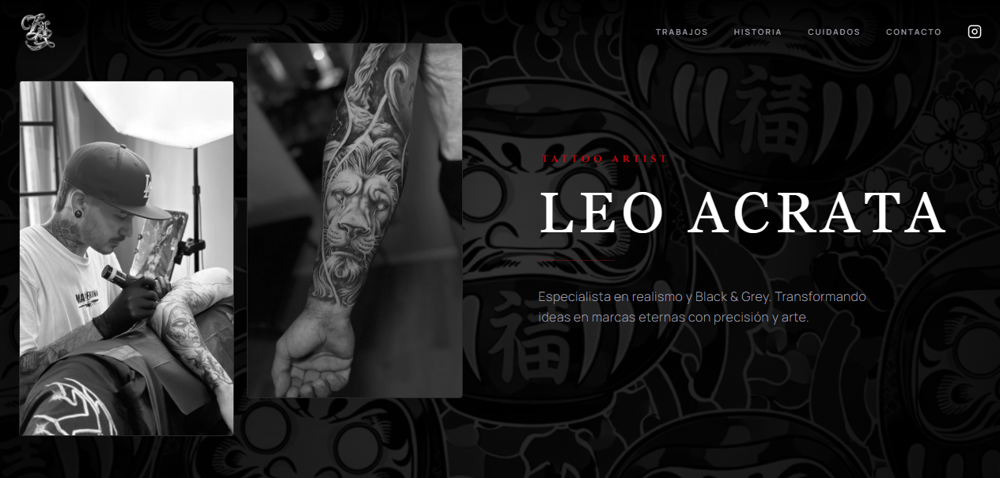

# Leo Acrata Ink

Sitio web profesional desarrollado para **Leo Acrata**, tattoo artist especializado en realismo y Black & Grey.

Diseñado para presentar su trabajo, transmitir su identidad artística y facilitar la solicitud de presupuestos con imágenes de referencia.

## Sitio web

[Visitar Leo Acrata Tattoo](https://leoacratatattoo.com.ar/)

## Funcionalidades

- Diseño responsive para dispositivos móviles y escritorio.
- Portfolio fotográfico con carrusel interactivo.
- Visualización ampliada de los trabajos.
- Secciones de historia y cuidados posteriores.
- Formulario para solicitar presupuestos.
- Envío opcional de una imagen de referencia.
- Integración con Cloudinary y EmailJS.
- Validaciones y estados de carga, éxito y error.
- Imágenes optimizadas para mejorar el rendimiento.

## Tecnologías

React 19 · Vite · JavaScript · Tailwind CSS · Framer Motion · EmailJS · Cloudinary · Sharp · ESLint

## Autora

Desarrollado por [Martu Gallonetti](https://github.com/MartuGallonetti).

## Derechos

El contenido visual y las fotografías pertenecen a Leo Acrata. No se autoriza su reutilización comercial sin permiso.
